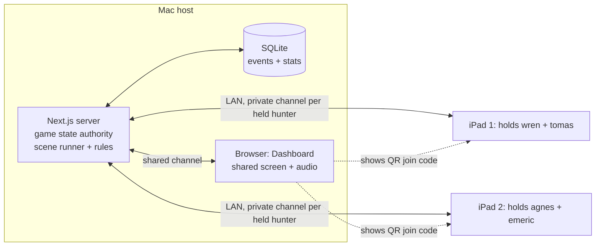

# Burgomaster's Funeral POC

Status: PRD draft for Bob's review, 2026-10-14 (**rev 6, 2026-10-15: the shared-screen target id is `storyboard` (the Story board, display only). PRD-40 names `apps/burgomaster-funeral-poc/assets/cues/cue-sheet.json`. Rev 5: ~16:15 ET, game length timing (R5-1, Bob): the POC measures how long each part of the scene takes (PRD-41..43) so full-game time per length can be extrapolated (R-LEN). Oct 15, Gamewright: accent reasons (R5-2) and pause-overlay host actions (R5-3).** Rev 4, 16:00 ET: tower control moves to Phase 2 (R4-1..R4-3); the POC drives no physical tower, every cue plays its screen half plus fallback audio, and E16 becomes a Dashboard ambient bed.** Rev 3, 15:45 ET: Gamewright rulings R3-1..R3-12 resolve 12 build questions; conflicting text fixed in place. Rev 2, 12:07 ET: hunters and devices R-DEV-9, R-WIZ-11, scene presence E15, revised variants rule). This is a design doc only. It contains no code.
Scene: `n2-burgomasters-funeral` (Dracula pack, night 2, the K2 Sanctuary). The script is used as reviewed, with no rewrite.
Sources: `research/stories/dracula/poc-funeral.md`, `research/stories/dracula/rulings.md`, `assets/stories/dracula/scripts/{n2-burgomasters-funeral,README,cast,props}.md`, `research/game-design/*` (requirements, story-engine, sessions, statistics, setup-wizard-and-summary, landing-and-initial-screens, look-and-feel-harness, asset-organization), `research/tower/api-surface-7.1.2.md`.

**Rev 2 rules (Bob, 2026-10-14).** All 4 hunters (agnes, tomas, wren, emeric) are always in play, and only one human is required. Devices hold one or more hunters. Hunters move independently, and the hunters at the site when the scene starts are **present**. Presence is locked for the scene. `~no-<hunter>` variants play for absent hunters and are voiced and rendered.

**Stack for the build team (Bob's preferences, R-ENG-9):** Next.js + React, pnpm workspace, SQLite. The existing `apps/tower-poc` holds the tower link. Treat it as a black box: in **Phase 2** it is reused as the Mac-side tower service; the POC doesn't link it (R4-1). Don't redesign it here.

---

## 1. Purpose and success criteria

**Purpose.** Prove the engine end to end on one set piece in about 10 minutes, using the Mac host, the Dashboard, and 1 or more iPads or phones holding all 4 hunters. The POC exercises these systems:
- scripted moments (stills and clips) with cast and item variants
- a party choice that has a cost (the lid choice)
- automatic cues, each playing its screen half plus its fallback audio (the cue IDs map to the tower in Phase 2)
- a fight with a real win or lose branch
- a story flag
- private routing to each player's device
- a skull drop under the cap
- a night transition, a mini summary, and SQLite stats

**Success criteria (all required):**
- SC-1. The scene plays start to finish with no tower connected, every cue playing its screen half and fallback audio. (The tower-connected run is Phase 2, §13.)
- SC-2. No private text ever appears on the Dashboard.
- SC-3. A device that rejoins mid-scene gets the private state of every hunter it holds back.
- SC-4. The stats rows alone are enough to reconstruct what happened (choice, fight, costs, cues, devices).
- SC-5. Playtesters call the fight branch tense. Bob judges this and records it in the playtest notes.

## 2. Out of scope
- The full setup wizard. Only a stub is in scope: join, pick hunter. (Connect, calibrate and self-test are Phase 2.)
- **Tower control (R4-1).** The POC sends no commands to the physical tower and makes no tower connection. All tower requirements are collected in §13 Phase 2: tower control.
- Multi-night saves and campaign resume. The phase clock only ticks to night 3 and the POC ends there.
- The 1981 bookends (R-LF-9). A stub slot only, which can be silent or a placeholder.
- Final art. Draft renders are fine (R-AST-ORG-7).
- Late arrivals: presence is locked when the scene starts (E15 v1).
- Board movement UI. The POC sets each hunter's location in a Dashboard "Who is at the Sanctuary" step instead of tracking movement on the board.
- The full board setup checklist, random encounters, keys UI beyond a flag, the Count's agenda, other scenes, and the finale.
- Warriors and spirit. Story mechanics never touch them (Bob's ruling).
- Any work on `apps/tower-poc` internals.
- **Game length picker (R5-1).** The POC is one scene, so it has no Short/Standard/Long option (R-LEN-1, R-WIZ-12). It only measures timing (PRD-41..43) to feed full-game estimates.

## 3. Devices and architecture
- **Mac host (R-DEV-1, R-DEV-5).** Runs the Next.js server, holds the single authoritative game state, and writes SQLite. In the POC it has no tower link; the Bluetooth link through `apps/tower-poc` is Phase 2 (§13).
- **Dashboard (R-DEV-2).** A browser on the Mac at 1080p 16:9. It is the shared screen, and it plays shared audio (narration, music, sfx) (R-DEV-6).
- **Player devices (R-DEV-3, R-DEV-8).** iPads, or phones using the phone view (R-LF-10). They join by QR over the LAN (R-WIZ-10). Each device **holds one or more hunters** (R-DEV-9). It receives the private content of every hunter it holds, labelled by hunter name, and never talks to the tower. Several devices may hold the same hunter.

Routing rule: the server sends every moment to one target, either `storyboard` or `ipad:<hunter>`. `ipad:<hunter>` fans out to every device currently holding that hunter, and only if that hunter is present. The Story board channel never carries a `.private.*` payload. This is enforced on the server, not in the UI. The frozen POC still sends the wire value `dashboard` for this `storyboard` target; code, routes and tests are unchanged.

## 4. User flow
1. Bob starts the host app on the Mac and opens the Dashboard in a browser. The Dashboard shows a stub landing page with a "Burgomaster's Funeral POC" door.
2. **Join (R-WIZ-10).** The Dashboard shows a QR code and a numeric code below it. Each player scans and opens the join page. The phone layout is detected automatically. One human with one device is enough.
3. **Who holds whom (R-WIZ-11).** Each device picks one or more of agnes, tomas, wren and emeric. A hunter may already be held by another device. The Dashboard roster shows the holders of each hunter and flags any unheld hunter. **Start gate:** Begin stays disabled until all 4 hunters are held.
4. **Who is at the Sanctuary (E15).** The host marks each hunter present or away. Test default: wren + agnes present, tomas + emeric away. At least 1 must be present. The setting is locked when the scene starts.
5. **Party kit.** The Dashboard shows each hunter's corruption and carried story items (who carries the stake, and the holy symbol if the seed gives it), plus the skull supply. The host confirms.
6. **Tower init: Phase 2 (R4-1).** Skipped in the POC; see §13. The Dashboard starts its ambient bed (E16, PRD-39) here.
7. **Scene.** The moments play in order `.01 → .02 → .03 → .lid-choice → (~nailed | ~watched) → .04 → .05 → .06 (fight) → .07 | .07~fight-lost → .08 → .09.private.* → .10`. Stills advance when the host taps Next. Clips advance when they end, or on Next.
8. **Lid choice.** The Dashboard offers the party "Nail the lid (spend 1 stake)" or "Keep the stake and watch". Nail is hidden unless a present hunter carries a stake. The host confirms the party's choice.
9. **Fight.** At `.06` the Dashboard shows the fight panel with its foe count. The players resolve the fight (see §6) and the host enters Won or Lost. The cost is applied, and if a skull drop is due, the Dashboard asks players to drop a skull and waits for confirmation (R-SP-8).
10. **Private thoughts.** `.09.private.<hunter>` plays for each **present** hunter, on every device holding that hunter. A device holding several hunters shows each line labelled with the hunter's name. Absent hunters get no private line. Meanwhile the Dashboard shows a neutral line ("Each hunter has a private thought; check your device") and waits until every receiving device taps Continue or the host overrides.

At any point, if a holdings change leaves a hunter unheld, the game **pauses** (Dashboard: "Waiting for someone to hold <hunter>") until a device picks that hunter up (R-DEV-9).
11. **Dawn.** `.10` plays: the pressed-flower still on the Dashboard.
12. **Night transition.** The phase card for night 2 → night 3 shows on the Dashboard (D8).
13. **Mini summary (R-SUM).** The Dashboard shows the outcome, the lid choice, the fight result, costs, skulls, the flag, and cue stats. Each device shows its personal line plus a 1–5 fun rating.

## 5. Functional requirements

| ID | Requirement | Trace |
|---|---|---|
| PRD-1 | The Mac host owns the single game state and SQLite. All devices render from server state. (POC wording, rev 4; the tower-link half is Phase 2, §13.) | R-DEV-1, R-ENG-16 |
| PRD-2 | The Dashboard is a Mac browser page at 1080p 16:9 with the fixed play-view zones: phase/night, party resources (story items), corruption per hunter, skulls (supply and dropped tonight). (The tower status chip is Phase 2, §13.) Text is ≥28 px, key numbers ≥48 px. | R-DEV-2, R-LF-4, R-LF-5 |
| PRD-3 | The QR join screen shows the join URL as a QR code plus a numeric code. It can be opened from the Dashboard at any time ("Join iPad"). It refreshes when the token rotates and never shows private data. | R-WIZ-10, R-UI-11 |
| PRD-4 | The join flow lets a device pick one or more hunters, including hunters already held elsewhere. A phone is detected and given the R-LF-10 view, with an option to switch to the full layout. | R-DEV-3, R-DEV-8, R-DEV-9, R-WIZ-11, R-SES-17, R-LF-10 |
| PRD-5 | *Moved to Phase 2 (§13).* | |
| PRD-6 | *Moved to Phase 2 (§13).* | |
| PRD-7 | The scene runner plays the moments in script order, picks the variant per §7 condition rules, and plays event moments (`.lid-choice`) in addition to the base sequence. | R-AST-ORG-10, R-AST-ORG-13 |
| PRD-8 | Absent-hunter variants: for each hunter not present, play the `~no-<hunter>` variant. Combined variants such as `~nailed~no-wren` take precedence. If no variant exists and the replacement speaker is also absent, cut the line. A hunter who is held but not present is absent. | E15, rulings (variants rule revised), scripts README |
| PRD-9 | Item-gated variant: `.04~holy-symbol` plays instead of `.04` when the party holds the Holy Symbol. | poc-funeral |
| PRD-10 | Lid choice: Nail is offered only when a **present** hunter carries ≥1 stake (a stake carried by an absent hunter doesn't count). Choosing it removes 1 stake from a present carrier. Watch keeps the stake. The choice is stored as story state. | rulings (lid choice), E15, R-SP-3, R-FUN-2 |
| PRD-11 | Cues fire automatically from the moment's cue list with no per-cue confirm; in the POC each cue plays its screen half plus its fallback audio from the Mac. Physical steps (the skull drop) wait for confirmation. (POC wording, rev 4; tower half is Phase 2, §13.) | R-ENG-19, R-SP-8, D-DRA-8, R4-2 |
| PRD-12 | Every cue has a screen half and a fallback audio (heartbeat, skull-drop sting, etc.). In the POC both always play, since no tower is connected (R4-2). A cue sheet entry without a fallback fails the readiness check. Cues are referenced by name only (`dim-all`, `heartbeat`). (POC wording, rev 4.) | R-ENG-6, R-ENG-12, E13, R4-2 |
| PRD-13 | Cue design rules (POC): no waiting for a sound to end, and music, ambience and fallback audio come from the Mac only. (Tower cue rules and Verified/Library/GAP status are Phase 2, §13.) | R-AV-7, R-ASSET-5, E13 |
| PRD-14 | Fight at `.06`: the Dashboard shows the foe count from §6 and a Won/Lost entry. The result chooses `.07` or `.07~fight-lost`. | R-SP-1, R-SP-3 |
| PRD-15 | Fight-lost costs depend on the lid choice (§6) and apply only to present hunters: the corruption victim is picked from present hunters, and a lost item must be carried by a present hunter. The corruption cost goes through the instant-loss guard. | rulings, E9, E15, D-DRA-5 |
| PRD-16 | Story skull drop: at most 2 per night. If fewer than 6 skulls remain in supply, the drop becomes "+1 foe on night 5" (a ledger entry) instead. A drop is a confirmed physical step. A drop is a clock input, but for this POC it doesn't advance the phase (see OQ-6). | rulings, E14, R-ASSET-3, R-SP-8 |
| PRD-17 | `.06` sets the story flag `dracula.lead.ladys-rooms = true` (Dorka's lead) whatever the fight result, because the line plays in both branches. | poc-funeral, R-SP-1 |
| PRD-18 | Private moments `.09.private.<hunter>` go only to devices holding that hunter, and to all of them when several devices hold it. The server rejects any private payload sent to the Dashboard, and the Dashboard shows a neutral placeholder instead. | R-DEV-4, R-DEV-6, R-DEV-9, R-AV-4, R-LF-8, E10 |
| PRD-19 | A private moment for a hunter not present at the scene is not shown anywhere, even on devices holding that hunter. It is logged as `private_skipped_absent`. | E15, R-DEV-4 |
| PRD-20 | Rejoin: a device that disconnects and scans again, or reloads, reclaims its holdings with a device token, and the server restores, for each held hunter, the current private moment, status line and pending choice. A dropped connection does not release the holdings. If a disconnect leaves a hunter with no connected holder, play pauses (R3-2). The host can't force play on with an unheld hunter; play resumes when a holder rejoins or the host reassigns the hunter to any connected device from the Dashboard. Pause and resume are logged. | R-DEV-4, R-SES-17, R3-2 |
| PRD-21 | Phase clock: completing the scene advances night 2 → night 3 and shows the phase card. The POC ends at the night 3 card. | E1, R-ENG-17, R-ENG-22 |
| PRD-22 | Win/loss check after every state change. A third corruption would be Turned, but the guard prevents it in this scene. The check still runs and is logged. | R-SES-5, R-ENG-31 |
| PRD-23 | Append-only SQLite event log, plus the summary tables in §8. Times stored in UTC. Unknown values stored as null. Seed and pack version recorded. | R-STA-1, R-STA-2, R-STA-9, R-STA-10 |
| PRD-24 | Cue activity is logged per cue; in the POC every cue logs `fallback` with reason `no_tower`. Skull drops and E16 ambient accents are logged too. (POC wording, rev 4; tower activity logging is Phase 2, §13.) | R-STA-5 |
| PRD-25 | Mini summary on the Dashboard and on each device, computed only from stored stats, with a 1–5 fun rating per player. | R-SUM-1, R-SUM-3, R-SUM-5, R-SUM-6, R-SES-14 |
| PRD-26 | Media is pre-rendered and played from the asset index by stable ID. Nothing is generated live. Draft renders are allowed. Dashboard assets use `@dashboard` and devices use `@ipad`. A missing `@phone` falls back to `@ipad` or to text. | R-AV-5, R-AST-ORG-1, -7, -9, -14, R-DEV-7 |
| PRD-27 | A readiness check before play: every moment ID needed for the joined party resolves in the index, every private moment has a line for each joined hunter, every cue resolves with a fallback, and no private moment targets the Dashboard. | R-AST-ORG-8, R-DEV-6, R-ENG-10 |
| PRD-28 | *Moved to Phase 2 (§13).* | |
| PRD-29 | The run is deterministic: the same seed + party + choices + fight results give the same moments, state and E16 Dashboard accents (accent timing and choice come from the game seed and are logged). (POC wording, rev 4; host tower-mode changes join the inputs in Phase 2.) | R-ENG-8, R3-4 |
| PRD-30 | Touch targets on the devices are ≥44 pt with primary actions in the thumb zone. The phone view shows one decision at a time and gives a haptic tap on a private cue. | R-LF-6, R-LF-10, R-FUN-11 |
| PRD-31 | "End for now" and "Concede" can be reached from the Dashboard during play, and both are logged. | R-SES-16 |
| PRD-32 | All 4 hunters are always in play, whatever the number of humans or devices. One device holding all 4 hunters is a valid game. | R-DEV-9 |
| PRD-33 | Start gate: Begin is disabled, and the wizard lists the unheld hunters, until every hunter is held by at least one device. | R-DEV-9, R-WIZ-11 |
| PRD-34 | Holdings can be changed from the Dashboard (and from the device for its own holdings) at any time. If a change leaves a hunter unheld, play pauses: no moment advances, no cue fires and choices are locked until a device holds that hunter. Then play resumes from where it stopped. | R-DEV-9 |
| PRD-35 | A device holding several hunters shows each private moment in its own card, headed with that hunter's name and portrait. Choices and status are per hunter, with a hunter switcher on the phone view. | R-DEV-9, R-LF-10 |
| PRD-36 | Scene presence: each hunter has a location. When the scene starts, the hunters at the site are recorded as present and the set is locked for the scene. A hunter marked present later does not join it. At least 1 hunter must be present for the scene to start. | E15 |
| PRD-37 | All present-hunter effects (choices offered, costs, rewards, items counted) use only present hunters and the items they carry. Items carried by absent hunters are untouched. | E15, R-ENG-28 |
| PRD-38 | Stats log device holdings (each join, change and release, with a snapshot at start), pauses for unheld hunters, and the locked presence set for the scene. | R-DEV-9, E15, R-STA-11 |
| PRD-39 | E16 in the POC: the Dashboard is never idle. It runs an ambient bed per phase (screen light pulse plus ambient audio from the Mac) and one-shot accents (screen pulse plus sound) every 20–60 s, suppressed during speech, choices and pauses, and overridden by scene cues. Accent timing and choice come from the game seed and are logged. The quiet gap during play is ≤10 s. | E16, R3-4, R4-2 |
| PRD-40 | The cue sheet (`apps/burgomaster-funeral-poc/assets/cues/cue-sheet.json`) stays the contract: each cue ID carries its screen half and fallback audio now, and Phase 2 maps the same cue IDs to tower commands without renaming them. | R4-3, E13 |
| PRD-41 | Timing instrumentation (rev 5). Using a monotonic clock (wall time stored alongside for display only), the host timestamps: every phase start/end; every moment start/end; each investigation pick (time from prompt to lock, per hunter); table-talk duration; battle screen open to Won/Lost result; each cue's start/end (duration); and every pause start/end (any cause: unheld hunter, host pause, disconnect). Pauses are excluded from active time. Rows are stored in SQLite stats with the game record. | R-LEN-4, R-LEN-5, R-STA-2, R5-1 |
| PRD-42 | End-of-POC timing summary on the Dashboard (in the mini summary): total, active and paused time, and time per phase. Exportable as CSV and JSON from the stored rows (no display-only numbers). | R-LEN-5, R-SUM-6, R-STA-8, R5-1 |
| PRD-43 | Extrapolation formula, documented here, not built: **est. game time (per length) = Σ(set pieces in that length × measured set-piece time) + (expected encounters × measured encounter time) + (fights × measured fight time) + (nights × per-night overhead for dusk/dawn)**. Inputs come from POC runs (PRD-41 data; this scene gives set-piece, investigation, table-talk and fight times); encounter and dusk/dawn times are pending until measured. The formula lives in the docs, not the build. | R-LEN-4, R5-1 |

Total: 43 requirement IDs (rev 5 adds PRD-41..43; rev 2 adds PRD-32..38 and revises PRD-4, -8, -10, -15, -18, -19, -20). Rev 4 adds PRD-39, -40, moves PRD-5, -6, -28 to Phase 2, and rewrites PRD-1, -2, -11, -12, -13, -24, -29 for the POC (original text kept in §13).

## 6. Game state and rules

**Party.** All 4 hunters (agnes, tomas, wren, emeric) are always in play. State per hunter: `corruption` (0–2 in the POC; 3 = Turned), `holders` (set of device ids, which must not be empty while play runs), `location`, `present` (locked at scene start), `carried_items`. Absent hunters are away elsewhere on the board: the script's `~no-<hunter>` variants cover their lines, and scene effects don't touch them.

**Devices.** 1 or more. Each device holds 1–4 hunters, and a hunter may have several holders. Test default: iPad 1 holds wren + tomas, iPad 2 holds agnes + emeric.

**Story items (carried per hunter, counted only when the carrier is present).** `stake` (count), `holy-water`, `host`, `holy-symbol` (the Lantern of Saint Ysolde; it gates `.04~holy-symbol`). Starting kit: see OQ-3. Story items are the only cost currency. Warriors and spirit are never touched.

**Lid choice (`.lid-choice`):**
| Choice | Immediate | Fight | If the fight is lost |
|---|---|---|---|
| `~nailed` (offered only if a present hunter carries a stake) | stake −1 (from a present carrier) | foes = base −1 (min 1) | party loses 1 story item carried by a present hunter; **no** skull drop |
| `~watched` | none | foes = base (full strength) | 1 present hunter +1 corruption (guard applies) **and** 1 story skull drop (cap applies) |
Either way Dorka rises and the `.06` lead line plays.

**Fight.** Base foe count and how the fight is resolved are open (OQ-1). Suggested default: base = number of hunters present, resolved at the table and entered on the Dashboard as Won/Lost.

**Item loss (nailed + lost).** The party picks which item from those carried by present hunters (suggested default). If no present hunter carries an item, nothing is lost and the event is logged as `cost_unpayable`.

**Corruption + instant-loss guard (watched + lost).** The party picks a **present** hunter. Any hunter at 2 corruption can't be picked. If every present hunter is at 2, the cost is redirected: the party loses 1 story item carried by a present hunter instead (E9 `~blocked`). If no present hunter carries an item either, log `cost_unpayable`. Every corruption counts (D-DRA-5). Cures aren't offered in this scene.

**Skull drop.** A per-night counter `story_skull_drops[night]`, with a cap of 2. Before a drop: if supply < 6, add `finale_ledger.extra_foes += 1` instead. If the cap is already reached, skip the drop and log it. Otherwise the Dashboard asks the players to drop 1 skull into the tower and waits for "Done". Supply −1. The skull is dropped into the unpowered tower as a table step; the tower's `onSkullDrop` record is Phase 2 (§13).

**Story flag.** `dracula.lead.ladys-rooms = true`, set on `.06`.

**Phase clock.** It starts at night 2 (second set piece, after the procession). At the end of the scene it moves to night 3 and shows the D8 card. The skull-drop counter resets per night.

**Win/loss.** Checked after each change. The only reachable terminal state here is Concede.

## 7. Moment and cue table

Asset status for every row: **not rendered** (no `assets/rendered/dracula/` or `story.json` exists yet). Every line needs voice, **including every `~no-<hunter>` variant** (revised variants rule: they are live, so voice and render them). Speakers come from cast.md: narrator Charon, agnes Kore, tomas Algenib, wren Erinome, emeric Fenrir, dorka Laomedeia (*new*, needs audition).

| Moment ID | Kind | Condition | Target | Cue (Phase 2 tower status) → screen half + fallback audio (both always play in the POC) | Assets needed |
|---|---|---|---|---|---|
| `.01` | clip | always | storyboard | none | dusk wake clip `@dashboard`; music: plainchant; sfx: candles, weeping; narrator VO |
| `.02` | still | wren present | storyboard | none | wake still; agnes + wren VO |
| `.02~no-wren` | still | wren absent | storyboard | none | same still; agnes VO |
| `.03` | still | emeric present | storyboard | none | coffin/flies still; sfx: flies; emeric VO |
| `.03~no-emeric` | still | emeric absent | storyboard | none | same still; narrator VO |
| `.lid-choice` | still (event) | after `.03` | storyboard | `heartbeat` (Library: breathe effect) → screen pulse on the vignette + low heartbeat sfx from the Mac | leaning-candles still; sfx: fly then silence; narrator VO; choice UI |
| `.lid-choice~nailed` | still | nailed, wren present | storyboard | none | hammer/stake still; sfx: hammer; wren + narrator VO |
| `.lid-choice~nailed~no-wren` | still | nailed, wren absent | storyboard | none | same still; tomas + narrator VO |
| `.lid-choice~watched` | still | watched, agnes present | storyboard | none | watching still (candles out at the back); agnes + narrator VO |
| `.lid-choice~watched~no-agnes` | still | watched, agnes absent | storyboard | none | same still; tomas + narrator VO |
| `.04` | clip | no holy symbol | storyboard | `dim-all` (Library: all lights off) → screen fades to near-black for 1.5 s; `heartbeat` (Library) → screen pulse + heartbeat sfx | Dorka-sits-up clip; sfx: wood creak; narrator VO |
| `.04~holy-symbol` | clip | holy symbol held | storyboard | same cues and fallbacks | variant clip with lamp flare; narrator VO |
| `.05` | clip | agnes present | storyboard | none | Dorka coaxing clip; dorka + agnes VO |
| `.05~no-agnes` | clip | agnes absent | storyboard | none | same clip; dorka + tomas VO |
| `.06` | clip + fight | tomas present | storyboard | none (tower sound is stinger-only, and no fight stinger is scripted) | chaos clip; sfx: screams, benches; music: low drums; tomas + dorka VO; fight panel; sets flag |
| `.06~no-tomas` | clip + fight | tomas absent | storyboard | same | same clip; wren + dorka VO |
| `.07` | still | won, wren present | storyboard | none | Dorka-at-peace still; narrator + wren VO |
| `.07~no-wren` | still | won, wren absent | storyboard | none | same still; narrator VO |
| `.07~fight-lost` | still | lost | storyboard | `skull-drop` (player physical step, not a tower command) → Story board prompt + confirm; only when watched | window/escape still; narrator + wren VO (see OQ-5 for wren absent) |
| `.08` | still | agnes present | storyboard | none | reuses the `.07` still, no new asset (R3-11); agnes VO |
| `.08~no-agnes` | still | agnes absent | storyboard | none | same; tomas VO |
| `.09.private.agnes` | still | agnes present | `ipad:agnes` (all devices holding agnes) | none | private still `@ipad` (`@phone` optional); agnes VO (thought) |
| `.09.private.tomas` | still | tomas present | `ipad:tomas` (all devices holding tomas) | none | same pattern; tomas VO |
| `.09.private.wren` | still | wren present | `ipad:wren` (all devices holding wren) | none | same pattern; wren VO |
| `.09.private.emeric` | still | emeric present | `ipad:emeric` (all devices holding emeric) | none | same pattern; emeric VO |
| `.10` | still | always | storyboard | none | dawn burial still with `pressed-flower` prop (needs the prop ref sheet); narrator VO |

All IDs carry the `n2-burgomasters-funeral` prefix. The Dashboard neutral line during `.09` is UI text, not a moment. The `pressed-flower` private dusk clue comes from the engine (`nx-pressed-flower`) and isn't part of this POC.

**Cue notes (rev 4).** In the POC no tower is connected, so every cue plays its screen half (including the screen pulse) **and** its fallback audio (heartbeat, skull-drop sting) every time (R4-2). The cue sheet is the contract: the IDs here are the ones Phase 2 maps to the tower (R4-3). Tower status (Library/Verified/GAP), calibration and tower-connected audio suppression are Phase 2 (§13).

## 8. Statistics events to log
Tables (statistics.md): `games`, `sessions`, `devices`, `game_heroes`, `clock_ticks`, `events`, `encounters`, `combats`, `resource_snapshots`, `inventory_changes`, `tower_activity`, `flags`, `outcomes`. `events` is the source of truth.

| Event type | Payload (key fields) |
|---|---|
| `session_started` / `session_ended` | seed, pack_version, tower_used (always false in the POC), end_reason |
| `device_joined` / `device_left` / `device_rejoined` | device_id, form_factor (ipad/phone), held hunters |
| `holding_changed` | device_id, hunter, action (take/release), by (device/dashboard), holders_after |
| `holdings_snapshot` | at game start: hunter → [device_id] for all 4 |
| `start_gate_blocked` | unheld hunters |
| `paused_unheld` / `resumed_held` | hunter, paused_ms |
| `presence_locked` | scene_id, present [hunters], absent [hunters], locations |
| `tower_connect` / `tower_calibrate` / `tower_selftest` / `tower_disconnect` | **Phase 2 only.** attempt, duration_ms, result, battery (null if unknown) |
| `moment_played` | moment_id (incl. variant), target, started_at, skipped (bool) |
| `private_delivered` / `private_acknowledged` / `private_skipped_absent` | moment_id, hunter, device_id (one row per receiving device) |
| `cue_fired` | cue name, capability, status (Verified/Library/GAP), result (sent/rejected/failed/fallback), reason. POC: result `fallback`, reason `no_tower` |
| `ambient_bed` / `ambient_accent` | phase, accent id, seed draw, started_at, suppressed (bool), reason |
| `lid_choice` | choice (nailed/watched), stake_before, stake_after, nail_offered (bool) |
| `fight_started` / `fight_resolved` | base_foes, foes, hunters, result (won/lost) |
| `cost_applied` | kind (corruption/item/redirected/unpayable), hunter, item, guard_triggered (bool) |
| `resource_changed` | resource (corruption:<hunter>, stake, holy-water…), value, delta, cause_event_id |
| `skull_drop_requested` / `skull_drop_confirmed` / `skull_drop_converted` / `skull_drop_capped` | night, drops_tonight, supply_before, ledger_delta |
| `flag_set` | key `dracula.lead.ladys-rooms`, value |
| `phase_advanced` | from_night 2, to_night 3 |
| `winloss_checked` | result (none) |
| `fun_rating` | hunter, rating 1–5, note |

## 9. Privacy and rejoin
- Server-side routing: private payloads are sent only on the owning hunter's channel. The Dashboard socket has no subscription that could receive them, and a test asserts this.
- A hunter's private moments go to every device holding that hunter, and only while that hunter is present. Players who share a hunter accept that they share its secrets. The join screen says so.
- On a device that holds several hunters, each private card is labelled with the hunter's name, so a line is never shown without saying whose it is.
- The Dashboard during `.09` shows only "Each hunter has a private thought." It never shows text, a still, or audio from a private moment.
- The QR and join pages show no hunter-private data. The hunter picker shows names and portraits only.
- Rejoin: on its first join a device gets a token tied to (session, device). On reload or a new scan, the token restores its holdings. A new device can always take an extra hold on any hunter, and the host must confirm if it is mid-scene. The server pushes the current private moment (if any), the status line and the pending decision.
- A disconnected device keeps its holdings, but if it was a hunter's only connected holder, play pauses (OQ-12 as resolved, R3-2). The host can't force play on; they resume by reassigning the hunter to any connected device from the Dashboard, or the device rejoins. Pause and resume are logged.
- A missing device blocks shared play only while it leaves a hunter unheld (R3-2). A device whose hunters are also held by another connected device doesn't block play: the host can advance, and its private moment waits for the device until the scene ends, then is logged as undelivered.
- Private audio plays on the device only (earbuds recommended).

## 10. Assets needed and status
| Group | Items | Status |
|---|---|---|
| Stills `@dashboard` | `.02`, `.03`, `.lid-choice`, `~nailed`, `~watched`, `.07`, `.07~fight-lost`, `.10` (`.08` reuses the `.07` still, R3-11). `~no-<hunter>` variants are rendered too (revised rule): an absent hunter must not appear in the frame, so a variant can reuse a base still only when that hunter isn't in it | Not started. Draft OK. **Needs image-generation billing enabled before rendering.** |
| Stills `@ipad` | 4 × `.09.private.<hunter>` | Not started. Draft OK. Needs image billing. |
| Clips `@dashboard` | `.01`, `.04`, `.04~holy-symbol`, `.05`, `.06` | Not started. Draft OK. Fallback: a still with code-driven parallax. |
| Voice | narrator, agnes, tomas, wren, emeric (assigned), dorka (*new*, audition), covering every base line **and every `~no-<hunter>` variant** | Not rendered |
| Music | plainchant (`.01`), low drums (`.06`) | Not started |
| SFX | candles, weeping, flies, fly then silence, hammer, wood creak, screams/benches, heartbeat (fallback), skull-drop sting (fallback), E16 ambient bed + accent sounds | Not started. Generic sounds may come from `assets/shared/sfx/` |
| Props | `pressed-flower` ref sheet (`props/pressed-flower/ref/`) | Not started |
| Cast refs | agnes, tomas, wren, emeric, dorka reference sheets | Not started |
| Cue sheet | `apps/burgomaster-funeral-poc/assets/cues/cue-sheet.json` entries for `dim-all`, `heartbeat`, `skull-drop`, `seal-sequence`, each with screen half + fallback audio (tower mapping is Phase 2, R4-3) | The file is in the asset kit |
| UI | QR join overlay, fight panel, lid-choice panel, D8 phase card, mini summary, P1/P3/P6/P7, phone view | Not started (engine look, R-LF-2) |

## 11. Acceptance tests
- AT-1. With no tower connected, the test default (2 iPads holding all 4 hunters; wren + agnes present), the scene plays `.01`→`.10` and reaches the night 3 card. At each cue the screen half is visible and the fallback audio is heard. (SC-1; rev 4 rewrite, tower version in §13)
- AT-2. In the same run every cue row shows `fallback` (reason `no_tower`): `dim-all` fades the screen, `heartbeat` pulses the vignette and plays the heartbeat sfx, and a watched + lost run plays the skull-drop prompt and sting. (SC-1; rev 4 rewrite)
- AT-3. Over a full run, capture every Dashboard payload. None contains any `.private.*` moment ID or its text. (SC-2)
- AT-4. Reload a device holding two hunters during `.09`. Within 5 s it shows the same labelled private moments and status lines, keeps its holdings, and logs `device_rejoined`. (SC-3)
- AT-5. Kill a device's network at `.05`. If it was a hunter's only holder, play pauses and the host has no force-continue; reassigning that hunter to another connected device from the Dashboard, or the device rejoining, resumes play with the hunter's state intact. If another connected device also holds the hunter, play continues. Pause and resume are logged. (R-DEV-4, R3-2)
- AT-6. With the only stake carried by an absent hunter (tomas), Nail is not offered. With a stake carried by a present hunter, Nail sets stake to 0 and the fight shows base −1 foes (min 1).
- AT-7. Nailed + lost: 1 chosen item carried by a present hunter is removed (items carried by tomas/emeric can't be picked), no skull prompt appears, and `cost_applied kind=item` is logged.
- AT-8. Watched + lost with a present hunter at 0: that hunter goes to 1 corruption (absent hunters aren't offered as the victim), a skull drop prompt waits for confirm, and the drop is logged.
- AT-9. Watched + lost with all present hunters at 2: no corruption is applied, the cost is redirected to an item, `guard_triggered=true`, and no Turned outcome.
- AT-10. With `story_skull_drops[2]=2` already, the drop is skipped and logged as `skull_drop_capped`. With supply 5, it converts to `+1 foe night 5`.
- AT-11. Both fight outcomes set `dracula.lead.ladys-rooms=true`.
- AT-12. Variants, test default (wren + agnes present, tomas + emeric away): plays `.02`, `.03~no-emeric`, `.lid-choice~nailed` or `~watched`, `.05`, `.06~no-tomas`, `.07`, `.08`, and private `.09` for wren and agnes only. A present carrier with the holy symbol plays `.04~holy-symbol`.
- AT-12b. Variants, alternate presence (tomas + emeric present, wren + agnes away): plays `.02~no-wren`, `.03`, `.lid-choice~nailed~no-wren` / `~watched~no-agnes`, `.05~no-agnes`, `.06`, `.07~no-wren`, `.08~no-agnes`, and `.07~fight-lost~no-wren` (narrator only; R3-12, OQ-5). Together, AT-12 and AT-12b play every `~no-<hunter>` variant in the script.
- AT-13. *Moved to Phase 2 (§13).*
- AT-14. From the event log alone, a script can reconstruct the moment sequence, the lid choice, the fight result, the costs and the skull outcome. (SC-4)
- AT-15. Two runs with the same seed, party, choices and fight results produce identical event payloads, including logged E16 Dashboard accent timing and choice, apart from wall-clock times and ids. (R-ENG-8, R3-4)
- AT-16. A phone join shows the R-LF-10 single-column view with one decision at a time, and buzzes on a private cue.
- AT-17. The readiness check fails if any `.09.private.<hunter>` or any `~no-<hunter>` variant is missing voice or render, or a cue has no fallback.
- AT-19. Start gate: with 3 of 4 hunters held, Begin is disabled and the wizard names the unheld hunter. Once a device takes it, Begin enables. `start_gate_blocked` and a `holdings_snapshot` are logged.
- AT-20. Shared hunter: iPad 1 and iPad 2 both hold wren. At `.09`, both show wren's line (identical) and log one `private_delivered` row each. The Dashboard shows nothing private.
- AT-21. Multi-hunter device: one device holding all 4 hunters can play the whole scene alone. At `.09` it shows the wren and agnes cards, each labelled with the hunter's name, and nothing for tomas or emeric (absent).
- AT-22. Unheld pause: mid-`.05`, the Dashboard releases agnes from her only holder. Play pauses (no Next, no cues, choices locked) with "Waiting for someone to hold Agnes". When a device takes agnes, play resumes at the same moment. `paused_unheld` / `resumed_held` are logged.
- AT-23. Presence lock: marking tomas present after `.01` has started changes nothing in this scene (`.06~no-tomas` still plays, and tomas gets no `.09` line). `presence_locked` lists wren + agnes.
- AT-24. Absent privacy: emeric's holder receives no `.09.private.emeric` while emeric is away, and `private_skipped_absent` is logged.
- AT-25. Disconnect without release: killing the network of the only holder of tomas does not pause the game, and on reconnect the holdings are intact.
- AT-18. Playtest: players rate the fight branch as tense (Bob's notes). (SC-5)
- AT-31. Timing log (rev 5, PRD-41): after a full run, the timing rows contain every phase and every moment played, each with a start and end; investigation picks, table talk, the battle screen and cues have durations; and a forced pause (AT-22) appears as a pause row whose time is excluded from active time.
- AT-32. Timing summary (rev 5, PRD-42): the summary's active time equals the sum of the phase times (pauses excluded), total = active + paused, and the CSV/JSON export matches the on-screen numbers.

## 12. Open questions and assumptions
Each item is an **assumption** with a suggested default, which the build follows unless Bob overrides it.

| ID | Question | Assumption / suggested default |
|---|---|---|
| OQ-1 | Base foe count and how the fight is resolved ("spawn shape, per mechanics" is undefined) | Assumption: base foes = hunters present (1–4), with nailed = base −1 (min 1). The fight is resolved on the table with RtDT battle rules, and the host enters Won/Lost. There is no in-app battle engine. |
| OQ-2 | Test configuration (replaces the old 2-player Wren + Agnes party) | Assumption: all 4 hunters on 2 iPads (iPad 1: wren + tomas; iPad 2: agnes + emeric). Wren + agnes are present at the funeral, and tomas + emeric are away. A second pass with the presence flipped (AT-12b) covers the other variants. All `~no-<hunter>` variants are voiced and rendered. |
| OQ-3 | Starting kit when the scene is played stand-alone | Assumption: wren carries 1 stake, agnes 1 holy water, and tomas 1 stake (away, so it can't be used, as a test of that rule). No host. The holy symbol is a test toggle (default off). Corruption is 0 for everyone, with a debug preset of "one hunter at 2" for the guard test. Skull supply is 12 (debug: 5). |
| OQ-4 | Who picks the corruption victim and the lost item | Assumption: the party decides at the table and the host taps the choice on the Dashboard, from present hunters only. Phone/iPad voting is out of scope. |
| OQ-5 | `.07~fight-lost` has a Wren line but no `~no-wren` variant | **Resolved (R3-12):** with wren absent, `.07~fight-lost~no-wren` plays narrator only. Open script item: Loremaster writes it. |
| OQ-6 | Does the funeral's skull drop advance the clock (R-ASSET-3), and does it count as the phase trigger? | Assumption: log it as a clock input but don't advance the phase. Only scene completion advances night 2 → 3 in this POC. |
| OQ-7 | *Moved to Phase 2 (§13), with the tower test.* | |
| OQ-8 | Does the `.10` outcome award K2's key? ("with the site, the kingdom's key") | Assumption: no keys in this POC. Log `key_eligible=false` and show nothing. |
| OQ-9 | Does the 1981 bookend play? | Assumption: a silent stub slot only (out of scope). |
| OQ-10 | Advance rule for stills | Assumption: the host taps Next on the Dashboard, with no auto-advance timer. A clip advances when it ends. |
| OQ-11 | Image billing for draft stills | Assumption: Bob enables image billing before the render pass. Until then, use placeholder frames with caption text, so the flow can be built and tested. |
| OQ-12 | Does a disconnected sole holder count as "unheld" for the pause? | **Resolved (Bob; R3-2):** yes. Holdings persist, but a hunter with no connected holder pauses play until a holder rejoins or the host reassigns the hunter from the Dashboard. |
| OQ-13 | How is presence set without board tracking? | Assumption: the Dashboard step "Who is at the Sanctuary" before `.01`, defaulting to wren + agnes. At least 1 must be present. |
| OQ-14 | Can a hunter change holders during a pending private choice? | Assumption: yes. The pending choice moves to the new holders, and the first answer wins. |

## Decisions after review (2026-10-14)
- **OQ-12 resolved (Bob):** if the only device holding a hunter disconnects, play pauses immediately, the same as PRD-34. **AT-25 is replaced:** disconnecting a hunter's only holder pauses play, and reconnecting or a new holder resumes it.
- **Presence exemption (E15a):** dusk and night-start moments, including the pressed-flower clue, ignore presence. They go to every holder of the named hunter.
- **Never idle (E16), rev 4 POC form:** the Dashboard runs an ambient bed for each phase (screen light pulse plus ambient audio: dusk breathe, wake flicker) plus seeded one-shot accents every 20–60 s. These are suppressed during speech, choices and pauses, and scene cues override them. The quiet gap during play must be ≤10 s. Accents are seeded and logged (PRD-39). AT-26 (rev 4 rewrite): over a full run, the `ambient_bed`/`ambient_accent` log and the screen show no gap longer than 10 s outside of pauses. (The tower light bed, host toggle and tower-log AT-26 are Phase 2, §13.)
- **Effects (rev 4):** in the POC the skull-drop sting, the heartbeat sound and the screen pulse always play (R4-2); tower-connected suppression is Phase 2 (§13). The iPad hunter card shows the items that hunter carries, with the stake first.

- **Investigation round (E17), added by request:** before `.lid-choice`, each present hunter makes one private pick on their iPad (Loremaster is writing the actions and findings). Then comes a table-talk beat, then the lid choice. AT-27: findings appear only on the picking hunter's holders.
- **Investigation advantages (rulings.md, 2026-10-14):**
  - Ready Stake: +1 Undead to the picker.
  - Holy water: a carried story item, spent for +1 Undead or used as a price.
  - Consecrated Ground: +1 Wild for each present hunter, round 1 only.
  - Mother bars the window: -1 foe, stacks with the lid, minimum 1.
  - Forewarned: reveals the first battle card. It costs the picker 1 corruption or sitting out the fight (at 2 corruption they must sit out).
  - Story advantages are capped at +2 per hunter per fight.
  - The risky cue is a seal flicker plus a sound, with no drum move, and it fires after all picks lock. (POC: screen seal flicker plus sound; the tower flicker is Phase 2.)
  - AT-28 (rev 3, R3-1): the Dashboard battle status screen shows the present hunters, the foe count after modifiers (minimum 1), each hunter's advantages by trait with the +2 cap applied, and the Forewarned card if active; these match the rules above. The app runs no battle simulation; the host's Won / Lost tap is recorded and costs applied.

## Rev 3 rulings (Gamewright, Oct 14 2026)
Answers to 12 build questions. Where these conflict with earlier text, these win; the conflicting text above has been fixed in place.

**Process note.** At gate G0 this PRD serves as the intent, unless Bob writes a file under `intent/`, which then takes precedence.

1. **R3-1 No in-app battle.** Fights use the physical RtDT battle cards and tower as normal (this app sends the tower no commands in the POC, R4-1). The "battle screen" is a Dashboard status-and-entry screen showing: the present hunters in the fight; the foe count after modifiers (lid, mother bars the window; minimum 1); each hunter's advantages by trait with the +2 per-hunter cap applied; and the Forewarned card face up if active (the host draws the physical card and enters it, and the screen shows it). Host buttons: **Won** / **Lost**. The app only records the outcome and applies costs. AT-28 is reworded to match.
2. **R3-2 Pause wins (Bob).** If a hunter has no connected holder, play pauses. The host can't force play on with an unheld hunter, but can resume by reassigning the hunter to any connected device from the Dashboard, or the device rejoins. Pause and resume are logged. Amends PRD-20, §9 and AT-5.
3. **R3-3 R-UI-8 wins.** *(Suppression is Phase 2, §13; in the POC fallback audio always plays, R4-2.)* The screen half of a cue, including the screen pulse, always plays. Only the fallback audio (heartbeat, skull-drop sting) is suppressed, and only while the tower is connected and its sound works.
4. **R3-4 Seeded accents.** E16 accent timing and choice come from the game seed and are logged (POC: Dashboard accents). Host mode changes (Full, Lights only, Off) are logged inputs (Phase 2). Both are part of the determinism check (PRD-29, AT-15).
5. **R3-5 E15a in this scene.** No moment in `n2-burgomasters-funeral` is a dusk, night-start or dawn phase moment, and none is tagged `scope: global` (`.01` is a scene clip set at a wake and `.10` is a scene still that mentions dawn; neither is a phase moment, and neither has private lines). So the E15a exemption applies to no funeral moments, and `scope: global` would be the only exemption. The pressed-flower dusk clue (`nx-pressed-flower`) is engine-side and outside this POC.
6. **R3-6 Investigation (E17).** One pick per present hunter; absent hunters don't pick. No two hunters may pick the same action: the first lock wins and taken cards grey out. Picks are private until all lock. The table-talk beat ends when the host taps **Continue** on the Dashboard (no timer in the POC). Then the seal sequence fires.
7. **R3-7 Items.** Each stake is one story item for item loss. Holy water spent as a price is removed immediately when spent, before any later cost is picked. Holy water carried as +1 Undead counts toward the +2 cap; spent as a price, it gives no advantage.
8. **R3-8 Forewarned.** The picker hunter's holder chooses on their iPad; if the hunter is shared, the first answer from any holder locks and the others see it. At 2 corruptions the choice is forced to sit out (instant-loss guard: Forewarned can never cause the third corruption). Log `n2-burgomasters-funeral.forewarned.choice` with `hunter`, `choice` (`corruption` | `sit-out`) and `forced` (true/false).
9. **R3-9 End-of-scene, per hunter.** A device holding several hunters shows one fun rating and one personal line per hunter held. Stats are stored per hunter plus device id. Personal-line text comes from the script as moments `n2-burgomasters-funeral.end.private.<hunter>`, written by Loremaster; until then, use placeholder text from the manifest.
10. **R3-10 Self-test (resolves OQ-7). *Phase 2 (§13).*** Run the Library cues `dim-all`, then `heartbeat` lights, then the skull-drop sound. The host confirms seen/heard per step; a failed step switches that channel to screen fallback. **Verify at tower test.**
11. **R3-11 `.08` still.** `.08` reuses the `.07` still; no new asset. If `assets/manifest.json` has a separate `.08` still entry (placeholder only), point its path at the `.07` still and say so in its notes. (Applied: `apps/burgomaster-funeral-poc/assets/manifest.json` entry `.08` now points at the `.07` still, with a note.)
12. **R3-12 `.07~fight-lost~no-wren`.** With wren absent, `.07~fight-lost~no-wren` plays narrator only (E15 `~no-<hunter>` convention). **Open script item:** Loremaster writes it (also `n2-burgomasters-funeral.end.private.<hunter>` per R3-9).

## 13. Phase 2: tower control
Per R4-1, everything here is **Phase 2**: the POC does not build it. IDs and text are kept from rev 3 so Phase 2 can pick them up unchanged; Phase 2 maps the same cue IDs from the §7 cue sheet to the tower (R4-3).

**Tower connection, init and calibration**
- **PRD-1 (tower half) [Phase 2].** The Mac host owns the single game state, the tower link and SQLite. Mac host owns the Bluetooth link to the tower through the `apps/tower-poc` tower service and is the only thing that drives the tower.
- **PRD-2 (tower chip) [Phase 2].** Dashboard play-view zone: tower status chip.
- **PRD-5 [Phase 2].** Tower init stub: explicit Connect, explicit Calibrate with a cover screen (about 22 s), a self-test with a player confirm, and "Play without tower" at every step. Nothing is automatic and nothing is retried. (R-WIZ-9, R-SES-2, R-ASSET-11)
- **PRD-6 [Phase 2].** No tower command is sent while calibration is running. A cue that comes up during calibration is treated as rejected and its fallback is used. (R-ASSET-11, api-surface §2)
- **PRD-28 [Phase 2].** Disconnect during play pauses tower cues (fallbacks play), shows a manual Reconnect (with recalibrate) on the Dashboard, and never loses state. (R-SES-7)
- **§4 step 6 [Phase 2].** Tower init (R-WIZ-9 c–e, h): players press Connect explicitly. They then press Calibrate (about 22 s) while a looping "castle stirs" cover plays and no cues are sent. A self-test follows (one sound and one light), and players confirm they saw and heard it. They can choose "Play without tower" at any step. UI: calibration cover + fortune card.

**Cues sent to the tower**
- **PRD-11 (tower) [Phase 2].** Tower cues fire automatically from the moment's cue list with no per-cue confirm. Physical steps (the skull drop) wait for confirmation. (R-ENG-19, R-SP-8, D-DRA-8)
- **PRD-12 (tower) [Phase 2].** Every cue has a screen fallback, used when the tower is off or disconnected, when calibration is running, or when a cue is rejected. A cue map entry without a fallback fails the readiness check. Cues are referenced by name only (`dim-all`, `heartbeat`). (R-ENG-6, R-ENG-12, E13)
- **PRD-13 (tower) [Phase 2].** Cue design rules: no colour (effects only), no looping tower audio, no waiting for a sound to end, music and ambience from the Mac only, and every cue carries a status of Verified, Library or GAP. (R-AV-7, R-ASSET-5, E13)
- **PRD-24 (tower) [Phase 2].** Tower activity is logged per cue: sent, rejected, failed or fallback, plus calibration, self-test, disconnects, skull drops and battery; the tower's `onSkullDrop` is recorded when connected. (R-STA-5, R-WIZ-9)
- **Cue status [Phase 2].** `dim-all` = `allLightsOff`, and `heartbeat` = the breathe effect from `LIGHT_EFFECTS`. Both are library capabilities, marked **Library** until a spike marks them Verified. No cue in this scene is a GAP. Investigation risky cue: tower seal flicker plus a sound, no drum move.
- **Drum glyph turns [Phase 2].** No drum move is scripted in this scene; any drum glyph turn is a Phase 2 tower cue.

**Self-test (R3-10) [Phase 2]**
- **R3-10 [Phase 2].** Run the Library cues `dim-all`, then `heartbeat` lights, then the skull-drop sound. The host confirms seen/heard per step; a failed step switches that channel to screen fallback. **Verify at tower test.**
- **OQ-7 [Phase 2].** Cue status: are `dim-all` and `heartbeat` Verified on Bob's tower? **Resolved (R3-10):** Library until a tower-poc spike confirms them. The self-test runs `dim-all`, then `heartbeat` lights, then the skull-drop sound; the host confirms seen/heard per step, and a failed step switches that channel to screen fallback. Screen halves always play (R-UI-8). Verify at tower test.

**Tower-connected sound suppression (R3-3) [Phase 2]**
- The screen half of a cue, including the screen pulse, always plays. Only the fallback audio (heartbeat, skull-drop sting) is suppressed, and only while the tower is connected and its sound works. The skull-drop sting and the heartbeat sound play only without the tower, or when the self-test shows the tower's sound failing.

**E16 on the tower and host tower mode [Phase 2]**
- **E16 (tower) [Phase 2].** Ambient light bed on the tower for each phase (dusk breathe, wake flicker) plus random one-shot accents every 20–60 s, seeded and logged (R3-4). Suppressed during speech, choices and calibration; scene cues override them. Quiet gap ≤ about 10 s.
- **Host tower mode [Phase 2].** The host toggle offers Full, Lights only and Off; mode changes are logged inputs to determinism (PRD-29 original: "the same seed + party + choices + fight results + host tower-mode changes give the same moments, state and E16 accents").

**Phase 2 acceptance tests**
- **AT-1 (tower) [Phase 2].** With the tower connected, the test default (2 iPads holding all 4 hunters; wren + agnes present), the scene plays `.01`→`.10` and reaches the night 3 card. Cue rows for `dim-all` and `heartbeat` show `sent`. (SC-1, the tower test)
- **AT-2 (tower) [Phase 2].** The same run with "Play without tower": every cue row shows `fallback` and the screen fallbacks are visible.
- **AT-13 [Phase 2].** Pressing Calibrate, then a cue during calibration, logs `rejected/fallback` and sends no command. Nothing auto-retries after a forced connect failure.
- **AT-15 (tower) [Phase 2].** Determinism also holds with host tower-mode changes as inputs.
- **AT-26 (tower) [Phase 2].** Over a full run, the tower log shows no gap longer than 10 s outside of calibration and pauses.
- **AT-29 [Phase 2].** Self-test (R3-10): each step is confirmed seen/heard; failing a step switches that channel to screen fallback and is logged in `tower_selftest`.
- **AT-30 [Phase 2].** Tower-connected effects (R3-3): with the tower connected and sound passing self-test, the heartbeat and skull-drop sting fallback audio is suppressed while the screen pulse still plays.

## Rev 4 rulings (Bob, Oct 14 2026, ~15:57 ET)
Where these conflict with earlier text, these win; the conflicting text above has been fixed in place, and the tower text is kept in §13.
1. **R4-1 Tower control is Phase 2 (Bob).** The tower control code isn't ready, so the POC will not control the physical tower. All tower requirements move to §13, kept, not deleted.
2. **R4-2 Fallbacks are primary in the POC.** Every cue plays its screen half plus its fallback audio, always. E16 runs as a Dashboard ambient bed and accents (screen light pulse plus ambient audio), seeded and logged, idle gap ≤10 s.
3. **R4-3 Cue IDs unchanged.** The cue sheet stays the contract; Phase 2 maps the same cue IDs to the tower.

## Rev 5 rulings (Bob, Oct 14 2026, game length timing; Gamewright, Oct 15 2026, accents and pause)
Where these conflict with earlier text, these win. Consistent with rev 4: no tower in the POC, so cue durations are the screen half plus fallback audio.
1. **R5-1 Measure, don't guess (Bob).** The full game gets a startup length option (Short/Standard/Long, R-LEN, R-WIZ-12), but the POC has no picker, since it is one scene. The POC's job is to measure: it times every phase, moment, pick, table talk, fight and cue, excludes pauses from active time (PRD-41), shows and exports a timing summary (PRD-42), and its data feeds the documented extrapolation formula (PRD-43) that sets each pack's per-length time estimates (e.g. D-DRA-13, provisional).
2. **R5-2 Accent reasons (Gamewright, Oct 15 2026).** Each logged accent has exactly one reason: `choice`, `scene_cue`, `moment`, or `ambient`. Precedence: choice > scene_cue > moment > ambient, and the first match wins. `choice`: the moment is waiting on player input. That is `.investigate` and every `.investigate.*` id, `.lid-choice` and every `.lid-choice*` id, the Forewarned choice, and the battle screen (`.06` and `.06~no-tomas`). `.investigate` and `.lid-choice` log `choice` even when they also fire `heartbeat`. `scene_cue`: a cue-sheet cue that actually fires on that moment, including a variant that inherits the cue. A capped or converted skull drop does not fire `skull-drop`, so that moment is not `scene_cue`. `moment`: a plain moment start with no cue, such as `.01`. `ambient`: an E16 seeded filler accent.
3. **R5-3 Host controls during an R3-2 pause (Gamewright, Oct 15 2026).** The pause blocks game progress, not the host menu. The Dashboard pause overlay keeps Reassign hunter, Concede and End for now reachable. Next, Won, Lost and the other play choices stay locked. Reassign hunter and the host's confirm of a mid-scene take stay accepted, so the pause can still end. Concede and End for now each need one confirmation tap, and neither applies before that tap. Concede ends the game as a loss with the Taken ending, reason `conceded`, logged as `session_ended` with `end_reason` `conceded`. End for now saves this game's state and stats so it can resume, and is logged as `session_ended` with `end_reason` `paused-then-ended`. That save is a snapshot of this game; the campaign multi-night save UI stays out of the POC. Pause time stays out of active time (PRD-41).
