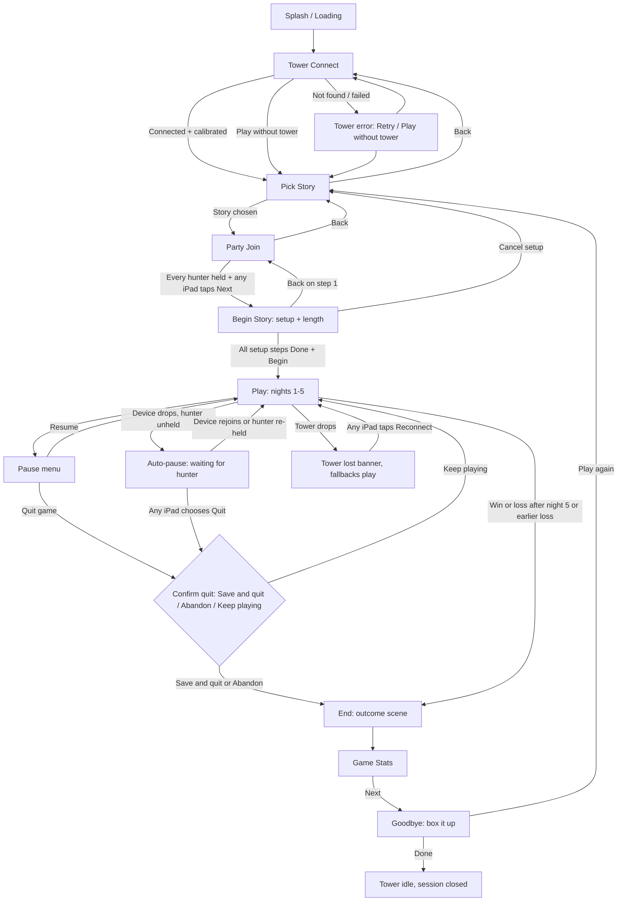

# bloodtower R2: game-flow screens (requirements)

Author: Gamewright (draft, 2026-10-16; revised 2026-10-16 with Bob's answers). Requirements only, no code. Status: decisions folded in; for Bob's review.

## 1. Purpose and scope

R1 closes as plumbing only: join, first-press-wins, timing log, tower link through the tower-poc sidecar (plan `apps/bloodtower/plans/R1-step1-foundation.md`, B1-B4; B4 = acceptance e2e). Bob's R1 test (Mac + 1 iPad holding all hunters) showed the UI is bare and the buttons are hard to find.

**R2 = the full game-flow UI**, from first launch to goodbye, laid out like a real game's start:
Splash/Loading -> Tower Connect -> Pick Story -> Party Join -> Begin Story (setup + length) -> Play -> End/Quit -> Game Stats -> Goodbye.

In scope: screen order, what each device shows, controls, entry/exit rules, errors, device modes, discoverability rules.
Out of scope: visual design. That comes later from Illusionist, building on the Stitch work in `research/look-and-feel` (README, prompts.md, screens/). This doc names *what* is on each screen, never how it looks. Also out: story content, the encounter/crypt rules themselves (story-engine.md, R-ENG), tower internals (apps/tower-poc is a black box; only its docs are used). Also out for R2: phones (iPads only, see Decisions).

### Sources reused (cite, don't restate)

| Source | Ids used |
|---|---|
| research/game-design/setup-wizard-and-summary.md | R-WIZ-1..12, R-SUM-1..7 |
| research/game-design/landing-and-initial-screens.md | R-UI-1..11 |
| research/game-design/requirements.md | R-DEV-1..9, R-SES-2, R-LEN-1..5, R-STA |
| research/game-design/story-engine.md | R-ENG-1..34, R-AV-1..7 |
| apps/burgomaster-funeral-poc/docs/poc-v2-flow.md | V2-1 (screen roles), V2-2 (flow controls on iPads, first press wins), V2-9 (splash then wizard) |
| apps/bloodtower/spec.md | §3 protocols, §6 tower safety, §8 R1 out of scope |
| apps/bloodtower/plans/R1-step1-foundation.md, B4-handoff.md | R1 steps, AC-1..AC-9, B3 follow-ups (token shown on join page; QR fails on loopback) |
| apps/tower-poc/docs/reuse-guide.md | "nothing physical happens automatically", every tower effect has a fallback, calibrate once at setup |

### Standing rulings applied (Bob)
- Story board = display only, Mac browser full screen on a TV (V2-1, R-DEV-8 note). No buttons, ever.
- iPads join by QR and do all control (V2-2). Any joined iPad may press any flow button; first press wins, as in R1. There is no host role.
- Holdings change on iPads only (R-DEV-9).
- iPads only in R2; no phone support yet (supersedes the R-DEV-8 phone stand-in for R2).
- `ipad:<hunter>` lines show as captions on that hunter's device only, never on the Story board (R-DEV-4). On a shared iPad they show openly, no tap-to-reveal.
- Shared moments auto-play on the Story board once every hunter in them has tapped Done.
- Ruling 12: lengths Short / Standard / Long chosen in setup; **every Dracula length plays 5 nights**; length changes the set pieces and crypt rooms.
- Talking avatar on the Story board; captions are the only fallback.

## 2. Flow

Devices can join from Tower Connect onward (the join QR is on the board from the end of Splash). Rejoin is possible from any screen: scanning the QR again or reopening the page with the saved device token returns the device to the current screen with its hunters (R1 AC-7).

## 3. Screens

Common to every screen (all screens below inherit these):
- R2-01. The Story board shows, on every screen after Splash, a status strip: tower state (connected / calibrating / lost / no tower), joined devices, and the current step name. Test: each screen's Story board snapshot contains the three fields.
- R2-02. Every iPad screen has exactly one primary button (see §5) and shows the step name and "what happens next" text. Test: UI audit per screen counts one primary button.
- R2-03. Flow buttons (Next, Choose story, Begin, Quit, Reconnect, Done for tonight) appear on every joined iPad. The first press wins; the other iPads move on with the flow and their press is ignored with no error, and the board names the device that pressed (as in R1). There is no host role. Test: two device contexts press at once; one transition, one log row.
- R2-04. Every press that changes the flow is logged with device and screen (extends R1 timing log). Test: timing rows exist for each transition.

### 3.1 Splash / Loading
- Purpose: sell the game in the first seconds (R-UI-1, V2-9) while the app loads packs and reaches the sidecar.
- Story board: title motion + ambient loop (R-UI-3), load progress, then the join QR + six-digit code once the server is ready.
- iPad: nothing until joined; a device that opens the join URL now sees "Game is loading..." and enters Tower Connect automatically when ready.
- Controls: none on Story board. On iPad: none (loading only).
- Entry: Mac app started and board page opened. Exit: packs loaded and sidecar reachable (or found unreachable) -> Tower Connect, automatically.
- Errors: pack lint failure -> board shows the error list and "Fix packs and restart"; sidecar unreachable -> continue to Tower Connect with tower state "service not running".
- R2-10. Splash advances to Tower Connect automatically within 2 s of load completing, with no input. Test: e2e timing.
- R2-11. Loads longer than 3 s show a looping fortune card (R-UI-10) instead of a bare spinner. Test: throttle load, assert card.
- R2-12. The board's join URL uses a LAN address; if only loopback is available the board shows "iPads can't reach this address" with the fix (closes B3 follow-up). Test: open board at 127.0.0.1, assert warning.

### 3.2 Tower Connect
- Purpose: connect and calibrate the tower right after Splash, user-initiated only (R-SES-2, R-UI-4, R-WIZ-9 sub-steps, tower-poc "nothing physical happens automatically").
- Story board: tower picture with sub-step status (searching, connected, battery, calibrating ~22 s with progress, ready), join QR still visible.
- iPad (any joined): big "Connect tower" button; then "Calibrate"; then "Next: pick a story". Secondary: "Play without tower".
- Entry: from Splash, or Back from Pick Story. Exit: calibrated, or "Play without tower" chosen -> Pick Story.
- Errors: tower not found (asleep, out of range, held by another app) -> plain cause + Retry + "Play without tower"; calibration fails -> Retry calibrate; low battery -> warning, still allowed.
- Note: a device must be joined to press Connect, so the first iPad scans the QR here. Joining is open from here on; hunters are claimed later, in Party Join, once the story is known.
- R2-20. No tower command is sent before a device presses Connect or Calibrate. Test: mock asserts zero commands until press.
- R2-21. "Tower not found" shows within 15 s of Connect with Retry and "Play without tower". Test: mock never answers.
- R2-22. "Play without tower" uses the mock and marks the game as no-tower in stats; every tower cue falls back to screen/audio. Test: mock mode run logs fallbacks.
- R2-23. The tower can be connected later from the pause menu (§3.6) without restarting. Test: start with no tower, connect mid-game.

### 3.3 Pick Story
- Purpose: choose which story pack to play; each story is a "door" (R-UI-2). The story decides the hunter list used in Party Join.
- Story board: the doors, the highlighted one with title, blurb, player count, and its motif (R-UI-9).
- iPad (any joined): swipeable but also arrowed list of story cards, primary "Choose <story>"; first press wins. Resume a saved game also lives here as a card ("Continue: Dracula, night 3").
- Entry: Tower Connect done, Back from Party Join, Cancel from setup, or "Play again" from Goodbye. Exit: story chosen -> Party Join. Back -> Tower Connect.
- Errors: pack fails validation -> door shown greyed with "Can't load"; only one story -> still shown, preselected.
- R2-40. Once chosen, the whole UI takes the story's theme within one screen change (R-UI-2). Test: theme token switches.
- R2-41. Saved games appear as cards on this screen and lead to the restore checklist (R-WIZ-7). Test: save, relaunch, card present.

### 3.4 Party Join
- Purpose: get every iPad in and every hunter of the chosen story held (R-WIZ-10, R-WIZ-11, R-DEV-3, R-DEV-9).
- Story board: large QR + code, the chosen story's hunter roster with the holder device name under each hunter (or "unclaimed"), count "4 of 4 hunters claimed".
- iPad: device name, the story's hunters as large toggle cards ("Mine" / held by X). Primary: "Next: set up the story" (disabled with reason until all held); any joined iPad may press it.
- Entry: story chosen (or Back from Begin Story step 1). Exit: all hunters held + Next -> Begin Story. Back -> Pick Story.
- Errors: device drops -> its hunters show "disconnected" on board, stay held for 60 s then become unclaimed; two devices claim same hunter -> first press wins, loser sees "Taken by X".
- On "Play again" with a different story, holdings carry over for hunters present in both stories; others start unclaimed.
- R2-30. The Next button stays disabled and states the reason ("Claim Mina") until every hunter is held. Test: e2e.
- R2-31. One device can claim all hunters in two taps or fewer ("Take all"). Test: UI count.
- R2-32. The join page never shows the device token (B3 follow-up). Test: DOM check.

### 3.5 Begin Story (setup incl. length)
- Purpose: run the setup wizard (R-WIZ-1..8, 12) driven from the iPads, shown on the board.
- Story board: current step illustration/board diagram (R-WIZ-4), progress bar, reveals (R-WIZ-8), and the chosen length/difficulty.
- iPad (any joined): step 1 = Game length Short/Standard/Long (default Standard, R-WIZ-12, R-LEN-1) + difficulty; each length shows "5 nights" and what it changes (set pieces and crypt rooms, per ruling 12) plus time estimate or "estimate pending" (R-LEN-4). Then one physical step per screen with "Done" (R-WIZ-6). Last: "Begin the story". Any iPad may press; first press wins. Hunter-specific setup (starting items) shows on the holder's iPad.
- Entry: Party Join complete. Exit: all steps Done + Begin -> Play. Back steps back (step 1 Back -> Party Join); "Cancel setup" -> Pick Story (confirm).
- Errors: device drops mid-setup -> setup continues on the remaining iPads; if every iPad drops, R2-104 applies.
- R2-50. Length is fixed once Begin is pressed and recorded (R-LEN-1, R-LEN-5). Test: no control to change it in Play.
- R2-51. Every length plays exactly 5 nights; the length option text never states a different night count and names what changes (set pieces, crypt rooms). Test: lint + UI text check. (C1, resolved by ruling 12.)
- R2-52. Every physical step needs its own Done; Begin is unavailable until all are Done. Test: e2e.

### 3.6 Play (summary level)
- Purpose: the main loop: nights 1-5, each with turns, set pieces, encounters, crypt, private lines (R-ENG, story-engine.md).
- Story board: night counter "Night 2 of 5", whose turn, the talking avatar narrating shared moments (captions as fallback), the current set piece/encounter scene, party status, pause banner when paused. Never private lines.
- iPad: whose-turn banner; for the active hunter, the choices for this turn as large buttons; "Done" for each moment; the hunter's private lines as captions (§4); holdings (items, etc.) editable here only. Every iPad: Pause menu button (always visible, top corner, labelled "Menu").
- Sub-flows:
  - Night/turn: board announces night; turn passes hunter to hunter; end of night summary.
  - Set pieces: shared scene auto-plays on the board once every hunter in it taps Done.
  - Encounters: the involved hunter(s) choose on their iPads; outcome plays on board.
  - Crypt: same pattern as encounters, with its own step list on the iPad.
  - Private lines (`ipad:<hunter>`): caption on that hunter's device; hunter taps Done to clear.
- Pause menu (any joined iPad, first press wins, V2-2): Resume (primary), Reconnect tower, Join another iPad (shows QR on board, R-UI-11), Change who holds whom, Quit game.
- Entry: Begin. Exit: win/loss -> End; Quit confirmed (Save and quit or Abandon) -> End.
- Errors: hunter unheld (device drop) -> auto-pause "Waiting for Mina's device", resume on rejoin or re-claim (R-DEV-9, AC-7); tower lost -> banner, fallbacks, no auto-reconnect, "Reconnect" on every iPad (R-SES-2); Story board browser closed/reloaded -> on reopen it resumes the current scene.
- R2-60. The board shows "Night N of 5" and whose turn at all times during Play. Test: snapshot each state.
- R2-61. A shared moment starts on the board within 1 s of the last involved hunter's Done, and never before. Test: e2e with staggered Done.
- R2-62. The iPad shows "Waiting for <hunters>" while others still need to tap Done. Test: e2e.
- R2-63. No `ipad:*` payload ever reaches the board (R1 AC-3 kept). Test: WS frame capture.
- R2-64. Quit needs a confirm with three choices: Save and quit / Abandon / Keep playing; Keep playing is the default. Test: e2e, all three.
- R2-65. A dropped device's hunter pauses the game at once and the pause clears on rejoin without any further press. Test: AC-7 extended.
- R2-66. Tower loss never stops the game; every cue has its fallback and every iPad sees "Reconnect tower" in the banner. Test: mock disconnect.

### 3.7 End / Quit
- Purpose: deliver the outcome (R-SUM-1, R-SUM-2 outcome scene).
- Story board: victory or defeat clip with avatar narration; for a quit, a short "the story pauses here" card (saved) or "abandoned".
- iPad: each hunter's private outcome line (caption, per §4); primary "See the stats" on every iPad, first press wins.
- Entry: win, loss, or quit confirmed. Exit: Next -> Game Stats.
- R2-70. Every end type (win, loss, save-and-quit, abandon) reaches Game Stats. Test: four e2e paths.

### 3.8 Game Stats
- Purpose: the summary (R-SUM-1..6, R-LEN-5, R-STA).
- Story board: party summary: outcome, nights played, total/active/paused time, per-night time, key moments.
- iPad: that hunter's personal stats and private storyline outcome (R-SUM-3); optional fun rating 1-5 + note (R-SUM-5). Primary: "Next" on every iPad.
- Entry: End. Exit: Next -> Goodbye.
- R2-80. All shown numbers come from stored stats (R-SUM-6). Test: recompute from DB.
- R2-81. Rating is optional and never blocks Next. Test: e2e skip.

### 3.9 Goodbye
- Purpose: close the evening: box-it-up checklist and tower back to idle (R-SUM-7).
- Story board: thank-you card, teardown checklist (display only), tower state.
- iPad (any joined): checklist ticks; primary "Done for tonight" (tower to idle, session closed); secondary "Play again" -> Pick Story with the same devices.
- R2-90. "Done for tonight" sets the tower to idle and closes the session; devices get a closed screen. Test: mock idle command + session state.
- R2-91. "Play again" keeps devices and, where the next story has the same hunters, holdings. Test: e2e.

## 4. Device modes

iPads only in R2. There is no host role and no hand-off: any joined iPad may press any flow button, first press wins (R2-03).

| Mode | Behaviour |
|---|---|
| One iPad, all hunters (pass-and-play) | Whose-turn banner at top names the active hunter in large type. Hunter switcher: a row of hunter tabs; the active one is highlighted and the app auto-switches to the hunter whose turn or private line it is. Private lines show openly as captions labelled with the hunter's name ("Mina:"); no cover, no tap-to-reveal. Done clears them. |
| Several iPads | Each device shows only its held hunters; with one hunter no switcher; with several, the switcher as above. Private lines show openly on the holding device, labelled with the hunter's name. |

- R2-100. Private lines show openly on the device holding the named hunter, labelled with that hunter's name, with no cover or reveal step, and never on any other device or the board. Test: e2e on shared and personal devices.
- R2-101. The device auto-switches to the hunter who must act, and the banner names them. Test: e2e turn change.
- R2-102. Removed (host role dropped; replaced by R2-03 first-press-wins).
- R2-103. Removed (host-drop handover no longer applies).
- R2-104. If every device drops, the game pauses and the board shows the QR with "Rejoin to continue". Test: e2e.
- Phone mode row removed (no phone support in R2). It had no ids of its own; R2-100..104 keep their numbers (R2-102, R2-103 marked removed), and the phone size in R2-111 is dropped.

## 5. Discoverability rules (Bob's R1 complaint)

- R2-110. One primary action per screen, visually dominant, labelled with a verb + object ("Connect tower", "Begin the story"). Test: UI audit.
- R2-111. Primary buttons are at least 64 pt tall on iPad, with text labels, never icon-only. Test: layout check.
- R2-112. The next step is always visible: every iPad screen shows "Next: <step>" or "Waiting for <who> to <what>". Test: audit every screen state.
- R2-113. No hidden gestures: no swipe, long-press or double-tap is the only way to do anything; every action has a visible button. Test: audit.
- R2-114. Disabled buttons say why ("Claim all hunters first"). Test: audit.
- R2-115. The Story board mirrors the step: it always says what the table is waiting for, so players looking at the TV know where to look. Test: snapshot.
- R2-116. A first-run test with Bob: from Splash to first turn with no help, in under 10 min, with no "where do I tap" questions. Test: moderated playtest.

## 6. Decisions (Oct 16 2026)

Bob's answers, folded into the sections above:
- D1. Flow buttons: any joined iPad may press; first press wins, as in R1. No host role, no hand-off (R2-03; R2-102/103 removed). Answers old Q1 and Q5.
- D2. Pick Story comes before Party Join; the story decides the hunter list (§2, §3.3, §3.4). Answers old Q2.
- D3. Shared iPad: private lines show openly, no tap-to-reveal (§4, R2-100). Answers old Q3.
- D4. The tower connects right after Splash (§3.2). Answers old Q6.
- D5. Quit offers three choices: Save and quit, Abandon, Keep playing (R2-64). Answers old Q7.
- D6. No phone support yet, iPads only. Phone view dropped; its ids are marked removed, not renumbered (§4, R2-111). Answers old Q8.
- D7. Game-length question dropped: ruling 12 settles it. Every Dracula length plays 5 nights; length changes set pieces and crypt rooms (§3.5, R2-51). Answers old Q4.

## 7. Open questions for Bob

None from the original list; all eight are answered (§6). New, minor:
- Q9. When "Play again" picks a different story with a different hunter list, is carrying over holdings for shared hunters (§3.4) right, or should everyone re-claim? Default in this doc: carry over shared hunters.

## 8. Conflicts with existing requirements (resolved)

| # | Existing | Conflict | Resolution |
|---|---|---|---|
| C1 | R-LEN-2 "length sets the number of nights"; R-WIZ-12 "number of nights" as option meaning | All lengths play 5 nights | Resolved by ruling 12 (D7). Amend R-LEN-2 and R-WIZ-12: length changes set pieces and crypt rooms, never night count; R-LEN-3 per-length set piece lists stay. |
| C2 | R-WIZ-1 "wizard on the Dashboard ... with Next/Back" | Story board is display only | Resolved by standing ruling (board display only, iPads do all control). Wizard is driven from any joined iPad (first press wins) and mirrored on the board. |
| C3 | R-WIZ-9 "Tower initialization ... run from the Mac" | Control is on iPads; tower connect placed before story | Resolved by D4 plus standing ruling. Tower link runs on the Mac (R-DEV-5) but is pressed from an iPad, and the step moves to right after Splash, out of the setup wizard. |
| C4 | R-UI-5 shared screen "TV, Mac, or host iPad"; R-UI-11 "Dashboard Join iPad" button | Board has no buttons; there is no host iPad | Resolved by standing ruling and D1. The Story board (Mac on TV) is the only shared screen; drop "host iPad". Join QR is always on the board, and "Join another iPad" lives in the iPad pause menu. |
| C5 | V2-2 any joined iPad presses host controls | Draft proposed a host role | Resolved by D1: V2-2 stands. Any joined iPad presses flow buttons, first press wins; no host role. |
| C6 | R-WIZ-5 fixed step order / R-WIZ-11 "who holds whom" as a wizard step | Draft had Party Join before Pick Story | Resolved by D2: Pick Story, then Party Join, then the rest of setup. Amend R-WIZ-5 order to match; R-WIZ-11 stays a step, placed after story choice. |
| C7 | Docs still say "Dashboard" (R-DEV-2, R-WIZ, R-SUM) | Renamed Story board | Resolved as a naming fix: rename "Dashboard" to "Story board" in a doc pass. No design question left. |
| C8 | R-SUM-5 feedback / R-SUM-7 box-it-up on the Dashboard | Inputs must be on iPads | Resolved by standing ruling: rating entered on iPads; checklist shown on the board, ticked on any iPad. |

Also note for the doc pass: R-DEV-8 (phone as simplified stand-in) is deferred for R2 by D6.
